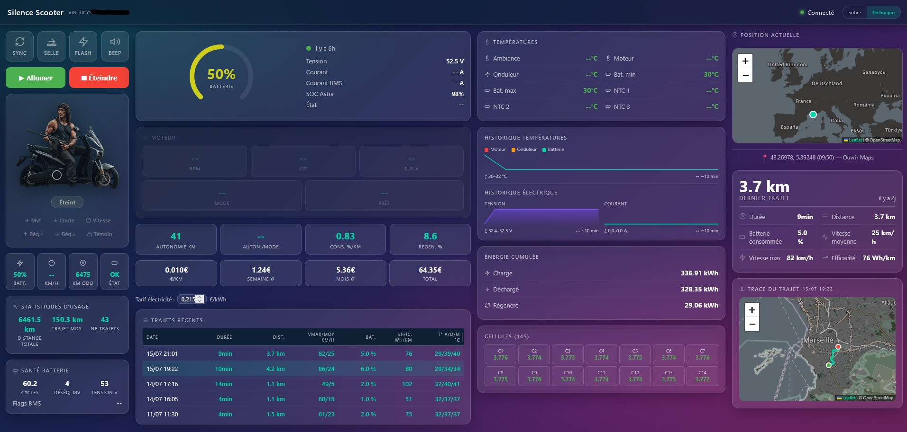
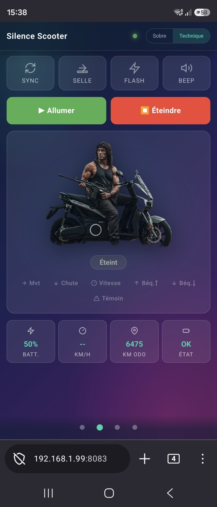

# Silence Dashboard

Tableau de bord auto-hébergé pour scooter électrique **Silence S01 / SEAT MÓ**.
Une stack Docker à coller dans Portainer : votre scooter se connecte à **votre** serveur, et vous suivez tout depuis un navigateur — sans cloud, sans compte, sans app.

## Aperçu





## Fonctionnalités

- **Télémétrie en direct** : vitesse, batterie (SOC), odomètre, températures, état de charge — poussés en MQTT/WebSocket dès que le scooter émet
- **Commandes à distance** : allumer / éteindre, ouvrir la selle, flash, klaxon+flash, synchronisation immédiate (`SYNC`)
- **Deux modes d'affichage** : *sobre* (l'essentiel : batterie, autonomie, statut, trajets, position) ou *technique* (cockpit complet : cellules batterie, diagnostics, sparklines)
- **Historique des trajets** : détection automatique (une session moteur = un trajet), avec durée, distance, consommation, vitesses, efficacité Wh/km et **tracé GPS sur carte OSM** (Leaflet)
- **Position en direct** : carte avec marqueur suivi au fil des fixes GPS
- **Coûts d'usage** : estimation semaine / mois / total selon votre tarif électricité
- **PWA** : installable sur l'écran d'accueil mobile, fonctionne hors ligne (shell)

## Architecture

```
Scooter ──TCP 38955──► silence-server ──MQTT──► mosquitto ──WebSocket 9002──► navigateur :8083
```

| Service | Rôle |
|---|---|
| `silence-server` | Proxy TCP qui intercepte la connexion du scooter et publie la télémétrie en MQTT |
| `mosquitto` | Broker MQTT (1883 interne, WebSocket 9001 exposé sur 9002) |
| `mqtt-retain` | Republie les messages en `retain` (snapshot instantané au chargement) et enregistre les trajets dans `trips.json` |
| `dashboard` | Page HTML statique servie par nginx, connectée directement au broker en WebSocket |

Aucun middleware (pas de Node-RED, pas de base de données externe).

## Prérequis

- Docker + Portainer sur votre serveur
- Port **38955** joignable par le scooter (ouverture/redirection selon votre réseau)
- L'**IMEI** du scooter (visible dans l'app Silence ou sur l'écran du scooter)
- Le scooter redirigé vers votre serveur — voir la [documentation de silence-private-server](https://github.com/lorenzo-deluca/silence-private-server)

## Déploiement (Portainer)

1. **Stacks → Add stack**, nommer la stack (ex. `silence-dashboard`)
2. Coller le compose ci-dessous dans l'éditeur
3. Dans **Environment variables**, ajouter : `IMEI` = votre IMEI (ex. `860123456789012`)
4. **Deploy the stack**

```yaml
services:

  mosquitto:
    build:
      context: https://github.com/Balou866/SilenceDashboard.git
      dockerfile: mosquitto/Dockerfile
    container_name: mosquitto
    restart: unless-stopped
    ports:
      - "9002:9001"
    volumes:
      - mosquitto-data:/mosquitto/data

  mqtt-retain:
    build:
      context: https://github.com/Balou866/SilenceDashboard.git
      dockerfile: mqtt-retain/Dockerfile
    container_name: silence-retain
    restart: unless-stopped
    volumes:
      - trip-data:/data

  silence-server:
    build:
      context: https://github.com/Balou866/SilenceDashboard.git
      dockerfile: silence/Dockerfile
    container_name: silence-server
    restart: unless-stopped
    environment:
      - IMEI=${IMEI:-TON_IMEI}   # à définir dans "Environment variables" de Portainer
    ports:
      - "38955:38955"

  dashboard:
    build:
      context: https://github.com/Balou866/SilenceDashboard.git
      dockerfile: dashboard/Dockerfile
    container_name: silence-dashboard
    restart: unless-stopped
    environment:
      - IMEI=${IMEI:-TON_IMEI}
    ports:
      - "8083:80"
    volumes:
      - trip-data:/usr/share/nginx/html/data:ro

volumes:
  mosquitto-data:
  trip-data:
```

## Accès et ports

| Port | Service |
|---|---|
| **8083** | Dashboard (`http://<ip-serveur>:8083`) |
| 9002 | MQTT WebSocket (mosquitto) |
| 38955 | Connexion TCP du scooter (silence-server) |

## Configuration

Seul paramètre requis : **`IMEI`** (variable d'environnement de la stack).

L'IMEI est injecté au démarrage des conteneurs (`configuration.json` côté `silence-server`, `index.html` côté `dashboard`) — changer d'IMEI = modifier la variable dans Portainer et redéployer, rien d'autre.

## Topics MQTT

- Télémétrie : `home/silence-server/<IMEI>/status` (JSON)
- Commandes : `home/silence-server/<IMEI>/command/<CMD>` — `TURN_ON_SCOOTER`, `TURN_OFF_SCOOTER`, `OPEN_SEAT`, `FLASH`, `BEEP_FLASH`, `SYNC`

## Crédits

- [lorenzo-deluca/silence-private-server](https://github.com/lorenzo-deluca/silence-private-server) — serveur TCP/MQTT et rétro-ingénierie du protocole
- [noiwid/silence-scooter-homeassistant](https://github.com/noiwid/silence-scooter-homeassistant) — définition des données et inspiration du dashboard
